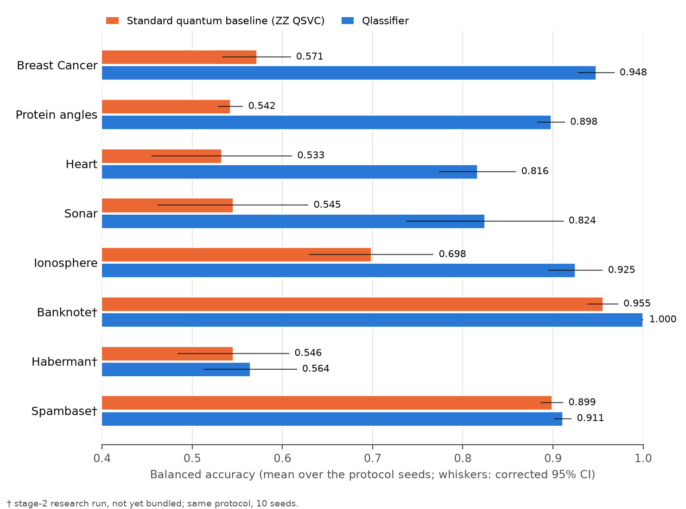
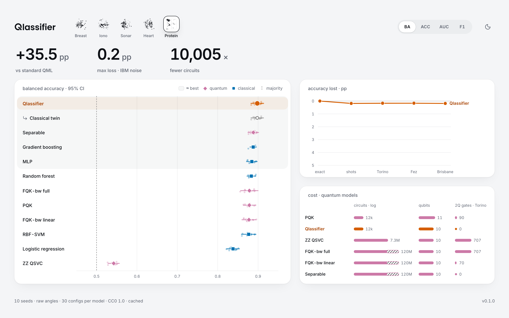

*Qiskit Fall Fest 2026 Warsaw*

<h1>
  <picture>
    <source media="(prefers-color-scheme: dark)" srcset="docs/assets/logo-dark.svg">
    
  </picture>
</h1>

**A quantum kernel classifier for tabular data, benchmarked against the standard quantum baseline and tuned classical models.**



## Install
Python 3.12. From a clone of this repository:

```bash
pip install .
```

The dashboard ships prebuilt, so there is no Node.js step. No GPU or IBM account needed.

## First result
```python
from qlassifier import Qlassifier, load_dataset
X_train, X_test, y_train, y_test = load_dataset("breast_cancer").split(seed=0)
clf = Qlassifier().fit(X_train, y_train)              # self-tuning on exact simulation
print(clf.score(X_test, y_test), clf.resources_)      # accuracy; qubits, circuits, 2-qubit gates, depth
```

`resources_` reports 15 qubits: 30 features, two per qubit. The benchmark reduces every dataset to 8 PCA features first, so there it reports 4.

With an IBM device noise model:

```python
from qlassifier import Qlassifier, load_dataset
X_train, X_test, y_train, y_test = load_dataset("breast_cancer").split(seed=0)
clf = Qlassifier(backend="fake_fez", random_state=0).fit(X_train, y_train)   # IBM Heron r2 noise model
print(clf.score(X_test, y_test))
```

For features that are angles, pass `geometry`. Each angle then gets its own qubit, so 359° and 1° stay close:

```python
from qlassifier import Qlassifier, load_dataset
data = load_dataset("protein_angles")
X_train, X_test, y_train, y_test = data.split(seed=0)              # chain-grouped split
clf = Qlassifier(geometry=data.geometry).fit(X_train, y_train)     # one qubit per angle
print(clf.score(X_test, y_test))
```

Your own CSV needs numeric feature columns and one binary target column (default: the last). `load_dataset("my_data.csv", target="target")` returns a dataset with the same `split`. `benchmark` runs every baseline on it under the same protocol; from the shell: `qlassifier benchmark my_data.csv --target target`. Files over 1,000 rows are sampled down to 1,000. Rows with missing values and text columns are dropped, with a note. 1,000 rows take a few minutes on a laptop. The dashboard shows the saved result next to the bundled datasets (see below).

```python
import pandas as pd
from qlassifier import benchmark, load_dataset
X_train, X_test, y_train, y_test = load_dataset("heart").split(seed=0)
pd.DataFrame(X_train).assign(target=y_train).to_csv("my_data.csv", index=False)   # stand-in for your file
print(benchmark("my_data.csv", target="target", seeds=3).summary())              # leaderboard on your CSV
```

## Dashboard and benchmark


```bash
qlassifier ui                           # dashboard
qlassifier benchmark breast_cancer      # one dataset: 12 models x 10 seeds
qlassifier benchmark --noise            # all datasets plus the noise study, as in the paper (hours)
```

- The dashboard opens on the saved results. `qlassifier benchmark` recomputes them.
- Results of your own data appear as extra tiles. `qlassifier ui` reads `./qlassifier-benchmark/`, where `qlassifier benchmark my_data.csv` saves; from Python, call `result.save("qlassifier-benchmark/my_data")`. Another folder: `qlassifier ui --results DIR`.
- `qlassifier benchmark` writes `REPORT.md`, per-seed tables and plots to `./qlassifier-benchmark/`.

## Results
<!-- results:begin (generated by scripts/paper_tables.py from the saved results; do not edit) -->

Balanced accuracy (BA), mean ± sd over 10 seeds. Δ = Qlassifier minus the other model, in percentage points, with the corrected 95% CI.

| Dataset | Qlassifier BA | Δ vs standard QML (ZZ) | Δ vs best classical |
|---|---|---|---|
| Breast Cancer | 0.948 ± 0.012 | +37.6 pp (10/10 seeds) | −1.3 pp [−3.1, +0.5] vs MLP: tie (0/10 seeds) |
| Ionosphere | 0.925 ± 0.018 | +22.6 pp (10/10 seeds) | −0.2 pp [−3.1, +2.7] vs RBF-SVM: tie (5/10 seeds) |
| Sonar | 0.824 ± 0.053 | +27.9 pp (10/10 seeds) | +0.5 pp [−8.5, +9.5] vs MLP: tie (6/10 seeds) |
| Heart | 0.816 ± 0.026 | +28.3 pp (10/10 seeds) | −1.0 pp [−3.1, +1.2] vs Logistic regression: tie (2/10 seeds) |
| Protein angles | 0.898 ± 0.009 | +35.5 pp (10/10 seeds) | +1.0 pp [−0.2, +2.2] vs Gradient boosting: tie (10/10 seeds) |

- **Noise:** under the IBM FakeTorino, FakeFez and FakeBrisbane noise models (1,024 shots), mean accuracy loss is at most 0.19 pp on any dataset; the lowest is −1.33 pp (a gain). Worst single seed: 0.94 pp (Ionosphere).
- **Cost (Breast Cancer):** 1,707 circuits to train and predict, 4 qubits, 0 two-qubit gates. The bandwidth-tuned fidelity-kernel pipeline needs 2,423,299 (1,420× more, including its on-device bandwidth search; its final Gram matrices alone need 147,061, 86× more).
- **Time:** `qlassifier benchmark breast_cancer` takes 56.2 s on an Apple M4 (10 cores).

<!-- results:end -->

## Limits
- Against tuned classical models the result is a statistical tie on every dataset.
- Real-hardware evidence is 5 runs on one device (`ibm_fez`), on one day's calibration, with 40 test rows each. Other device results use IBM noise models.
- Geometry mode has an exact classical equivalent: an RBF kernel on sin/cos features gives the same Gram matrix.

More detail in the paper's limitations section.

## Paper
[`docs/paper/main.pdf`](docs/paper/main.pdf) describes the method and all benchmarks.

## Notebooks
Install Jupyter with `pip install . --group docs jupyterlab`, then run `jupyter lab notebooks/`.

- [`01-quickstart`](notebooks/01-quickstart.ipynb): first fit, resources, and the ZZ baseline.
- [`02-geometry-mode`](notebooks/02-geometry-mode.ipynb): the angle encoding and its classical twin.
- [`03-reproduce`](notebooks/03-reproduce.ipynb): saved results, a small live rerun, noise and cost.

## Real hardware
We ran Qlassifier on a real IBM quantum computer to compare it with the noise simulation.

- **What ran:** Qlassifier's quantum features for Breast Cancer test samples, computed on `ibm_fez` (IBM Heron r2). Each sample takes 3 small circuits on 4 qubits, with no two-qubit gates.
- **Result:** 0.875–0.975 accuracy on 40 test samples, within 2 pp of what the noise simulator predicted, on all 5 seeds.
- **Scope:** 5 runs on `ibm_fez` on 2026-10-25, 410 QPU seconds in total. Training used exact features; only the test features came from the device. All other results are simulated.

Sources: the [experiment](experiments/hardware/e07-hardware-point/README.md) (script, pre-registered prediction, circuits, raw counts, IBM job records) and the [paper](docs/paper/main.pdf), Sec. IV G "On a real quantum processor".

## License
MIT, see [LICENSE](LICENSE).
