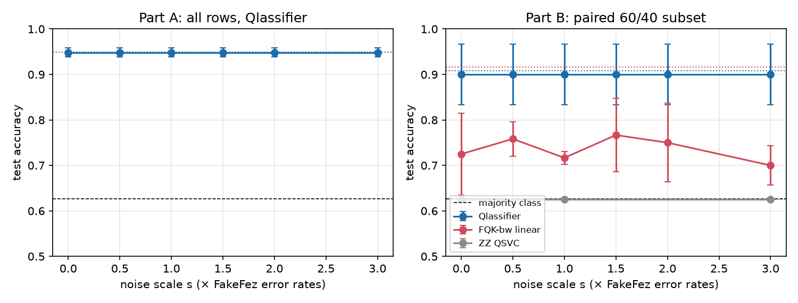

# e02 — noise sweep 0×–3× FakeFez (BT-2)

Up: [../README.md](../README.md) (protocol §2.3) · Log: [../learning-log.md](../learning-log.md) (H2) · Code: [`../common/noise_sweep.py`](../common/noise_sweep.py), [`analyze.py`](analyze.py) · Raw: [`cells.jsonl`](cells.jsonl) / [`cells.csv`](cells.csv) · Tables: [`summary.md`](summary.md) · Plot: [`accuracy_vs_noise.png`](accuracy_vs_noise.png) · Checks: [e00](../e00-setup-checks/README.md)

## What
Accuracy vs noise scale s ∈ {0, 0.5, 1, 1.5, 2, 3} × FakeFez (Heron r2) error rates on Breast Cancer: does Qlassifier stay within 2 pp at 1× and keep a higher area under the curve than the bandwidth-tuned fidelity kernel and the pinned ZZ baseline? Scale definition: every gate and readout error of the device Target × s, T1 and T2 ÷ s; same physical qubits and gates at every s (transpiled once at s = 1); 1,024 shots; sampler seed 11; density-matrix Aer; hyperparameters from exact-mode tuning.

## How
```
.cache/run_guarded.sh stage2-e02 env PYTHONPATH=experiments/hardware/common OMP_NUM_THREADS=1 \
  .venv/bin/python experiments/hardware/common/noise_sweep.py --out experiments/hardware/e02-noise-sweep --jobs 3
.venv/bin/python experiments/hardware/e02-noise-sweep/analyze.py
```
- Part A: Qlassifier, all 569 rows, eval seeds 0–4, six scales (30 cells, per-qubit simulation).
- Part B: paired stratified 60 train / 40 test subset of eval seeds 0–2; Qlassifier and FQK-bw linear at six scales (36 cells); ZZ QSVC (8 qubits, 433 CZ, depth 861) at s ∈ {0, 1, 3} on seeds 0–1 (6 cells of ≈ 18 min; curve interpolated between measured scales). Each model tuned in exact mode on the subset (`qlassifier.bench.noise._subset_config`).
- 3 workers (cells ≤ 1.6 GB each), longest cells first; finished cells are appended to `cells.jsonl` and skipped on restart.

## Result (72 cells; run 09:31–10:46 UTC, 3 workers under load; full tables in [`summary.md`](summary.md))


| Part | Model | Exact acc | s = 0 (shots only) | s = 0.5 | s = 1 | s = 1.5 | s = 2 | s = 3 | Kernel r (s = 1 → 3) | AUC acc | AUC BA |
|---|---|---|---|---|---|---|---|---|---|---|---|
| A (569 rows, seeds 0–4) | Qlassifier | 0.950 | 0.949 | 0.949 | **0.949** | 0.949 | 0.949 | 0.949 | 0.9983 → 0.9983 | 0.9485 | 0.9400 |
| B (60/40, seeds 0–2) | Qlassifier | 0.908 | 0.900 | 0.900 | 0.900 | 0.900 | 0.900 | 0.900 | 0.9982 → 0.9981 | **0.900** | **0.889** |
| B | FQK-bw linear (54 CZ, depth 169) | 0.917 | 0.725 | 0.758 | 0.717 | 0.767 | 0.750 | 0.700 | 0.956 → 0.872 | 0.738 | 0.700 |
| B (seeds 0–1, s ∈ {0, 1, 3}) | ZZ QSVC (433 CZ, depth 861) | 0.625 | 0.625 | — | 0.625 | — | — | 0.625 | 0.383 → 0.018 | 0.625 | 0.500 |

- **BT-2 (i):** part-A mean accuracy drop at s = 1 **+0.12 pp** (worst seed +0.58); BA drop +0.16 pp; identical at every scale from 0× to 3× (the device bias is below the 1,024-shot resolution; see below). Rule ≤ 2 pp → met.
- **BT-2 (ii):** part-B AUC accuracy Qlassifier **0.900** > FQK-bw linear **0.738** > ZZ QSVC **0.625** (BA 0.889 / 0.700 / 0.500) → met.
- Why the Qlassifier curve is flat (seed 0, part A, same sampler seed): the raw Bloch-vector norm shrinks 1.0012 (s = 0) → 0.9959 (s = 1) → 0.9852 (s = 3), i.e. the device adds a near-uniform shrink of ≤ 1.7% per qubit; after per-qubit renormalisation the mean |R − exact| is 0.0174 / 0.0175 / 0.0178, the binomial floor of 1,024 shots, and no component deviates by more than 3 binomial SE. With 0 two-qubit gates and depth ≤ 10 there is nothing else for the noise to act on.
- FQK-bw linear loses **19.2 pp already at s = 0** (shot noise alone on a 60-point Gram of a narrow-bandwidth fidelity kernel, after PSD repair; kernel r 0.995 yet the SVM margins flip), 20.0 pp at s = 1 and 21.7 pp at s = 3 (r 0.872). Correction to the stage-1 reading of "17.5–22.5 pp device-noise drop": most of it is sampling noise of P(0ⁿ), not gate error; gate error adds the trend above s ≈ 1.5.
- ZZ QSVC sits at the majority level on this subset in exact mode (BA 0.500), so its curve cannot fall; its kernel does: r 0.92 (shots only) → 0.38 (1×) → 0.02 (3×): 433 CZ gates destroy the Gram at 3× Heron r2 error rates.
- Real-hardware cross-check (e07, seed 0 subset, `ibm_fez`): 0.900 vs 0.900 here at s = 1 for the same rows (both 36 of 40 in e07; 35–36 across the prediction draws).

## Verdict
- **H2 confirmed → BT-2 met.** Qlassifier is flat across 0×–3× FakeFez error rates; the published-method baselines collapse (FQK-bw by shot noise first, then gates; ZZ by gates).
- Phase-8 design: ship the sweep as `noise_sweep(dataset, scales)` with the Target-scaling helper and the per-qubit path (Qlassifier cells cost seconds); fidelity-kernel cells need the density-matrix method and a worker cap (3.2 min for FQK-bw linear, 18–34 min for ZZ full per 60/40 cell). Plot: accuracy vs s with the exact line and the majority line, as above. State in the paper that FQK-bw's loss at 1,024 shots is sampling-dominated.
